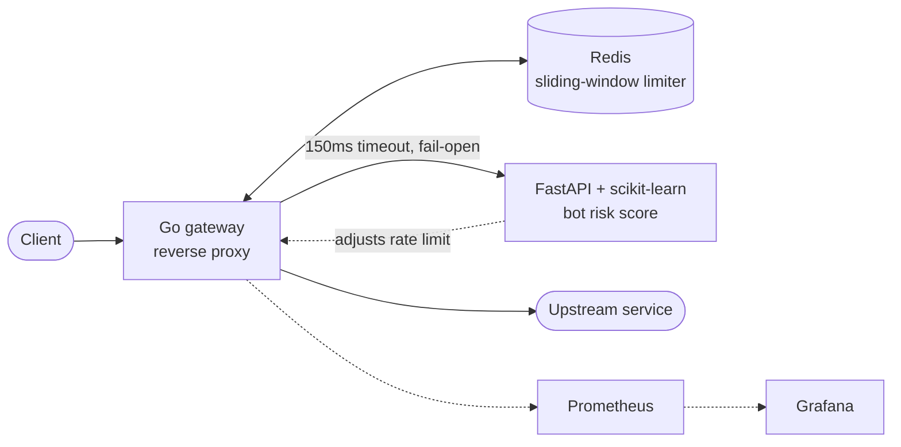
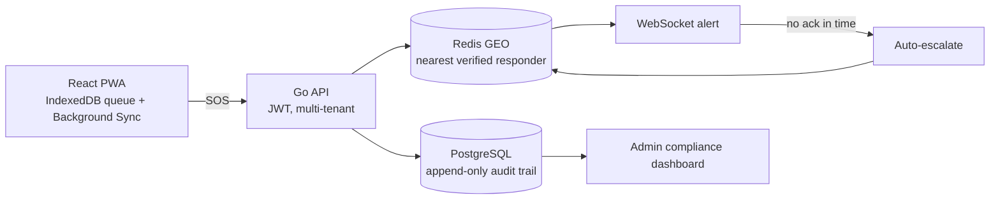
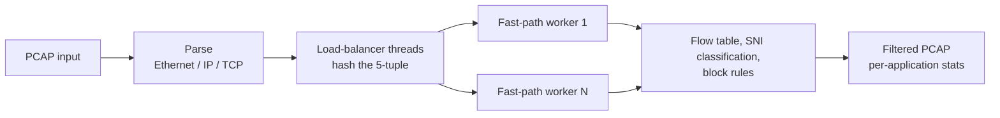

## Hi there 👋
<!-- Rename to README.md and place in your profile repo: github.com/Rishabh2815/Rishabh2815 -->

<div align="center">


<a href="https://github.com/Rishabh2815">
  
</a>

<br/>

<a href="https://www.linkedin.com/in/rishabh-jha-756345368"></a>
<a href="mailto:rrishabh2815@gmail.com"></a>


</div>

<br/>

## `$ whoami`

```go
package main

type Engineer struct {
	Name      string
	Focus     []string
	Education string
	Location  string
	Seeking   string
}

var rishabh = Engineer{
	Name:      "Rishabh Jha",
	Focus:     []string{"Distributed backend services", "Multi-threaded network software", "Systems design"},
	Education: "B.Tech CSE, ADGIPS (GGSIPU) - expected 2028 - CGPA 8.0/10",
	Location:  "Delhi NCR, India",
	Seeking:   "SDE / Technology internship, Summer 2027",
}
```

<br/>

## By the numbers

| **15.19 ms** | **99.17%** | **150 ms** | **200+** |
| :---: | :---: | :---: | :---: |
| p95 gateway latency at 50 VUs | bot-flood requests rejected (12,001 req at 200 req/s) | ML-scorer timeout, fail-open by design | LeetCode problems solved, Striver's SDE Sheet completed |

<br/>

## Featured projects

### Sentinel - API gateway with ML-based bot detection
`Go` `Redis` `Python (FastAPI, scikit-learn)` `Docker` `Prometheus` `Grafana` `k6`

A reverse-proxy gateway with Redis-backed atomic sliding-window rate limiting. A bot-scoring microservice adjusts each client's limit in real time, and it is a fail-open dependency, so a model outage degrades detection but never gateway availability. Load-tested with k6 on a Docker Compose stack.



<br/>

### RakshaGrid - verified hyperlocal SOS dispatch
`Go` `React PWA` `Redis` `PostgreSQL` `WebSocket` `Docker` `Vercel`

Geo-matches a verified SOS to the nearest available verified responder (security, wardens, volunteers) using Redis geospatial search, and auto-escalates if nobody acknowledges in time. Offline-first PWA so requests survive connectivity loss. Selected for the **Grand Finale of Yantrika 1.0** (Faculty of Technology, University of Delhi).



<br/>

### WireSpectra - multi-threaded deep packet inspection engine
`C++` `PCAP` `TCP/IP` `TLS` `Multithreading` `CMake`

Parses Ethernet/IP/TCP headers from PCAP captures, tracks connections in a 5-tuple flow table, identifies applications by extracting SNI from TLS Client Hello packets, and enforces per-flow blocking by source IP, application and domain. Hash-based flow affinity guarantees every packet of a connection reaches the same worker.



<br/>

## Tech stack

<table>
  <tr>
    <td><b>Languages</b></td>
    <td></td>
  </tr>
  <tr>
    <td><b>Backend</b></td>
    <td> &nbsp;REST, Microservices, WebSockets, JWT, Rate Limiting, TCP/IP, TLS</td>
  </tr>
  <tr>
    <td><b>Data</b></td>
    <td></td>
  </tr>
  <tr>
    <td><b>Cloud and DevOps</b></td>
    <td> &nbsp;VPC, ALB/ASG, RDS, Route 53</td>
  </tr>
  <tr>
    <td><b>Observability and ML</b></td>
    <td> &nbsp;k6 load testing</td>
  </tr>
  <tr>
    <td><b>CS fundamentals</b></td>
    <td>Data Structures and Algorithms, OOP, Operating Systems, DBMS, Computer Networks, System Design (HLD and LLD)</td>
  </tr>
</table>

<br/>

## Achievements

- **Yantrika 1.0 Grand Finale** - RakshaGrid selected, organized by the Faculty of Technology, University of Delhi
- **Striver's SDE Sheet** completed (C++ solutions on GitHub) and **200+ LeetCode** problems solved
- **AWS Cloud Practitioner Essentials** certified

<br/>

## GitHub activity

<div align="center">


</div>

<br/>

## Let's talk

I'm looking for **Summer 2027 SDE / Technology internships** where I can work on backend, distributed systems or networking problems. The fastest way to reach me is email: **rrishabh2815@gmail.com**.

<div align="center">


</div>

<!--
**Rishabh2815/Rishabh2815** is a ✨ _special_ ✨ repository because its `README.md` (this file) appears on your GitHub profile.

Here are some ideas to get you started:

- 🔭 I’m currently working on ...
- 🌱 I’m currently learning ...
- 👯 I’m looking to collaborate on ...
- 🤔 I’m looking for help with ...
- 💬 Ask me about ...
- 📫 How to reach me: ...
- 😄 Pronouns: ...
- ⚡ Fun fact: ...
-->
